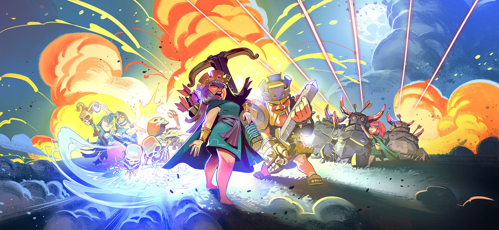

  <picture>
    <source media="(prefers-color-scheme: dark)" srcset="https://github.com/ClashKingInc/ClashKingAssets/blob/main/assets/logos/crown-text-dark-bg/ClashKing-with-text-3.svg">
    <source media="(prefers-color-scheme: light)" srcset="https://github.com/ClashKingInc/ClashKingAssets/blob/main/assets/logos/crown-text-white-bg/ClashKing-with-text-2.svg">
    
  </picture>

  
  
  
  
  

  Open-source tools for Clash of Clans players, clans, Discord communities, and developers.

  <a href="https://clashk.ing/">Website</a>
  ·
  <a href="https://discord.gg/clashking">Discord Server</a>
  ·
  <a href="https://discord.com/api/oauth2/authorize?client_id=824653933347209227&permissions=8&scope=bot%20applications.commands">Discord Bot</a>
  ·
  <a href="https://play.google.com/store/apps/details?id=com.clashking.clashkingapp">Android App</a>
  ·
  <a href="https://apps.apple.com/us/app/clashking/id6502886269">iOS App</a>
  ·
  <a href="https://docs.clashk.ing/">Docs</a>
  ·
  <a href="https://api.clashk.ing/docs">API</a>

---

## What Is ClashKing?

ClashKing v2 is an open-source ecosystem of tools built around Clash of Clans.

It helps players, clan leaders, Discord communities, and developers manage clan activity, track player progress, follow wars and CWL, organize rosters, view statistics, automate server workflows, and build with Clash of Clans data.

The ecosystem includes a Discord bot, mobile app, dashboard, backend API, tracking services, API proxy, shared assets, database schemas, testing tools, and Clash of Clans API libraries.

## Start Here

| If you want to... | Go here |
| --- | --- |
| Add ClashKing to your Discord server | [Invite ClashKing Bot](https://discord.com/api/oauth2/authorize?client_id=824653933347209227&permissions=8&scope=bot%20applications.commands) |
| Configure ClashKing for your server | [ClashKing Dashboard](https://clashk.ing/) |
| Download ClashKing on Android | [Google Play](https://play.google.com/store/apps/details?id=com.clashking.clashkingapp) |
| Download ClashKing on iOS | [App Store](https://apps.apple.com/us/app/clashking/id6502886269) |
| Read the documentation | [ClashKing Docs](https://docs.clashk.ing/) |
| Explore the public API | [API docs](https://api.clashk.ing/docs) |
| Use Clash of Clans API wrappers | [clashy.go](https://github.com/ClashKingInc/clashy.go) or [clashy.py](https://github.com/ClashKingInc/clashy.py) |
| Contribute to ClashKing | [DevKit Contributing Guide](https://github.com/ClashKingInc/DevKit/blob/main/CONTRIBUTING.md) |
| Join the community | [Discord](https://discord.gg/clashking) |

## The Team Behind ClashKing

ClashKing is built and maintained by a small team of developers, contributors, and community members who care about Clash of Clans tooling.

We work on ClashKing as a side project alongside our full-time jobs. The project exists because we enjoy building useful tools for players, clans, and communities.

The ecosystem is developed across multiple areas: Discord bot features, mobile app development, dashboard work, backend services, tracking infrastructure, API tooling, design, documentation, testing, and community support.

Because ClashKing is large, the team focuses on long-term maintainability, practical features, reliable data, and tools that are useful for real clans and communities.

Community feedback plays a big role in shaping ClashKing. Bug reports, feature ideas, testing, documentation improvements, and contributions all help move the project forward.

## Main Projects

| Repository | Description |
| --- | --- |
| [ClashKingBot](https://github.com/ClashKingInc/ClashKingBot) | Open-source Clash of Clans Discord bot for clan management, player lookup, war tools, stats, reminders, and server automation. |
| [ClashKingApp](https://github.com/ClashKingInc/ClashKingApp) | Mobile companion app for ClashKing and Clash of Clans. |
| [ClashKingDashboard](https://github.com/ClashKingInc/ClashKingDashboard) | Dashboard used to configure and manage ClashKing. |
| [ClashKingAPI](https://github.com/ClashKingInc/ClashKingAPI) | Backend API powering ClashKing services. |
| [ClashKingDocs](https://github.com/ClashKingInc/ClashKingDocs) | Documentation for ClashKing features, commands, and workflows. |

## Backend, Infrastructure, and Data

| Repository | Description |
| --- | --- |
| [ClashKingTracking](https://github.com/ClashKingInc/ClashKingTracking) | Backend infrastructure for ClashKing tracking systems. |
| [ClashKingProxy](https://github.com/ClashKingInc/ClashKingProxy) | High-performance proxy for the Clash of Clans API. |
| [DevKit](https://github.com/ClashKingInc/DevKit) | Shared database schemas, infrastructure, design system, local dev tooling, and the `clashking` CLI. |
| [ClashTestingAPI](https://github.com/ClashKingInc/ClashTestingAPI) | Mock Clash of Clans API requests for testing. |

## Libraries and Developer Tools

| Repository | Description |
| --- | --- |
| [clashy.go](https://github.com/ClashKingInc/clashy.go) | Go wrapper for the Clash of Clans API. |
| [clashy.py](https://github.com/ClashKingInc/clashy.py) | Python Clash of Clans API wrapper, forked from `coc.py`. |
| [ClashKingAssets](https://github.com/ClashKingInc/ClashKingAssets) | Clash of Clans assets and extractor tooling. |
| [ClashKingTranslations](https://github.com/ClashKingInc/ClashKingTranslations) | Shared localization for ClashKing projects. |

## Supporting Repositories

| Repository | Description |
| --- | --- |
| [.github](https://github.com/ClashKingInc/.github) | Organization profile and shared GitHub configuration. |
| [Gists](https://github.com/ClashKingInc/Gists) | Random code snippets and experiments. |
| [num2words](https://github.com/ClashKingInc/num2words) | Utility for converting numbers into words. |

## For Players

ClashKing helps players:

- Track Clash of Clans accounts
- View player and clan statistics
- Follow wars and CWL
- Bookmark players and clans
- Access ClashKing-linked data through Discord and mobile
- Keep clan and account information organized

## For Clan Leaders and Communities

ClashKing helps clans, families, and Discord communities:

- Manage members
- Track wars, CWL, and clan activity
- Organize rosters
- Share clan information in Discord
- Automate common server workflows
- Improve visibility across multiple clans or community servers

## For Developers

Developers can use the ClashKing ecosystem to explore how Clash of Clans data is collected, processed, displayed, proxied, tested, and exposed through apps, bots, APIs, and shared libraries.

Useful repositories and resources for developers:

- [DevKit](https://github.com/ClashKingInc/DevKit)
- [API docs](https://api.clashk.ing/docs)
- [ClashKing Docs](https://docs.clashk.ing/)
- [ClashKingAPI](https://github.com/ClashKingInc/ClashKingAPI)
- [ClashKingTracking](https://github.com/ClashKingInc/ClashKingTracking)
- [ClashKingProxy](https://github.com/ClashKingInc/ClashKingProxy)
- [ClashTestingAPI](https://github.com/ClashKingInc/ClashTestingAPI)
- [clashy.go](https://github.com/ClashKingInc/clashy.go)
- [clashy.py](https://github.com/ClashKingInc/clashy.py)

## Contributing

Contributions are welcome!

Start with [DevKit](https://github.com/ClashKingInc/DevKit) and the [Contributing Guide](https://github.com/ClashKingInc/DevKit/blob/main/CONTRIBUTING.md) for local development setup, shared database schemas, design system conventions, and workflow instructions across repositories.

Depending on the repository, you can help by:

- Fixing bugs
- Improving documentation
- Reporting issues
- Suggesting features
- Testing changes
- Improving UI and UX
- Working on backend, bot, dashboard, mobile, infrastructure, or library code

Before contributing, please also check the README of the specific repository you want to work on. For large changes, it is a good idea to open an issue or join the [Discord](https://discord.gg/clashking) before diving in.

## Support ClashKing

ClashKing is entirely free to use.

There are no ads, no paid features, and no premium-only tools. We want the bot, mobile app, API, and community tools to stay available to everyone.

If you want to support the project and help us pay for infrastructure, you can:

- Use creator code `ClashKing` in the Supercell shop: [Support Creator](https://link.clashofclans.com/en?action=SupportCreator&id=Clashking)
- Subscribe through our Discord community: [Join Discord](https://discord.gg/clashking)
- Support us on Ko-fi: [ko-fi.com/clashking](https://ko-fi.com/clashking)
- Support us on Patreon: [patreon.com/clashking](https://www.patreon.com/clashking)

Every bit of support helps keep ClashKing running, free, and actively maintained.

## Community

Join the ClashKing Discord for support, feedback, updates, development discussion, and community help.

[Join the ClashKing Discord](https://discord.gg/clashking)

## Links

- GitHub Organization: https://github.com/ClashKingInc
- Website: https://clashk.ing/
- Documentation: https://docs.clashk.ing/
- API Docs: https://api.clashk.ing/docs
- Android App: https://play.google.com/store/apps/details?id=com.clashking.clashkingapp
- iOS App: https://apps.apple.com/us/app/clashking/id6502886269
- Discord: https://discord.gg/clashking
- Ko-fi: https://ko-fi.com/clashking
- Patreon: https://www.patreon.com/clashking
- Supercell Creator Code: https://link.clashofclans.com/en?action=SupportCreator&id=Clashking

## Disclaimer

ClashKing is an independent open-source project and is not affiliated with, endorsed, sponsored, or specifically approved by Supercell.

Clash of Clans and related assets are trademarks and copyrights of Supercell.

---

  Built by the ClashKing team for the Clash of Clans community.

